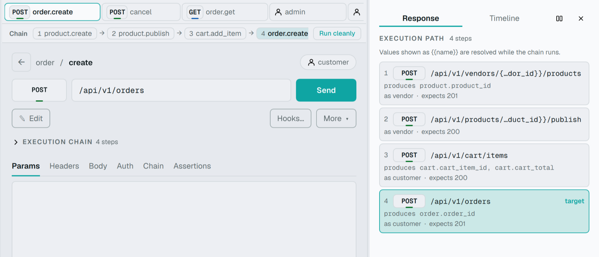

<div align="center">

<h1>
  
  Reqloom
</h1>

**A workflow-aware API testing tool that auto-resolves request dependency chains.**

[](https://github.com/Mirzabaig313/Reqloom/actions/workflows/release.yml)
[](https://github.com/Mirzabaig313/Reqloom/actions/workflows/build.yml)
[](https://docs.reqloom.tech/)
[](LICENSE)
[](https://github.com/Mirzabaig313/Reqloom/releases)

</div>

---

## What is Reqloom

Reqloom treats your API as a graph of resources, actors, and dependencies.
Define each actor (auth flow) and each resource (endpoints + dependencies)
once. Then invoke any endpoint and Reqloom auto-resolves the entire chain —
login, prerequisites, target call — and executes them in the correct order.

> Postman is an HTTP client. Reqloom is an API workflow engine.

<p align="center">
  
  <br>
  <em>Select order.create and Reqloom works out the chain: create a product, publish it, add it to the cart, then place the order.</em>
</p>

Next on the roadmap: the same engine opened to AI coding agents, so an agent can
run a chain and you watch it live in the app. See [Coming next](#coming-next).

📦 **Download:** Reqloom is in alpha. Grab the latest pre-release build for macOS (`.dmg`), Windows (`.exe` installer), or Linux (`.AppImage`) from the [Releases page](https://github.com/Mirzabaig313/Reqloom/releases).

## Why Reqloom

- **Dependency-aware execution.** Model resources and their prerequisites once;
  Reqloom computes the execution order and runs the full chain for you.
- **Actors as first-class citizens.** Authentication flows are declared once per
  actor and reused across every request that needs them.
- **Three ways to run.** A pure C++ engine library, a scriptable CLI, and a Qt 6
  desktop app — all driven by the same project definition.
- **Clean architecture, enforced.** The engine has zero UI dependency, and that
  boundary is mechanically verified at configure time and in CI.
- **Reproducible runs.** Every step is recorded, secrets are masked, and results
  export to text, JSON, and JUnit for pipelines.

## How it works

Describe each actor and resource once in YAML. Operations reference the outputs
of other operations (`{{order.order_id}}`) and declare explicit prerequisites
(`depends_on`). From those references the engine builds a dependency graph.

```yaml
# resources/refund.yaml
name: refund

operations:
  request:
    method: POST
    path: /api/v1/orders/{{order.order_id}}/refunds
    actor: customer
    depends_on: [order.pay]
    body: { reason: "Item not as described" }
    extract: { refund_id: $.data.id }

  approve:
    method: POST
    path: /api/v1/admin/refunds/{{refund.refund_id}}/approve
    actor: admin
    depends_on: [refund.request]
```

Invoking `refund.approve` resolves and runs the whole chain in order — actor
logins (reusing cached sessions), `order.create`, `order.pay`, `refund.request`,
then the target — with every extracted ID flowing automatically between steps.

## Features

### Available today

- **Dependency-graph execution** — resources, actors, and operations form a
  directed graph resolved with a topological sort; the engine runs prerequisites
  in order and stops on first failure.
- **Named auth strategies** — `simple`, `chain` (multi-step / OTP), `basic`,
  `bearer`, `api_key`, `jwt`, `oauth2_client_credentials`, `oauth2_password`,
  `oauth1`, `aws_sigv4`, and `mtls`, with per-actor session caching, TTL-based
  refresh, and a per-actor cookie jar. Credentials can also be set inline on a
  single operation or inherited from a project default.
- **Variable resolution** — reference session and resource outputs
  (`{{order.order_id}}`), environment values, and built-ins (`{{$.uuid}}`,
  `{{$.now+5m}}`, base64/hex/url codecs).
- **Polling** — model async `202 Accepted` flows with `poll_until`
  (predicate-driven success/fail, fixed interval or exponential backoff, and
  wall-clock plus attempt-count caps).
- **Iteration** — `for_each` runs one operation over every item an earlier
  operation produced.
- **Retries** — per-operation attempt budget with backoff; requests that are
  not safe to repeat are only re-sent when they provably never reached the
  server, unless the operation opts in.
- **Scripting hooks** — sandboxed pre-request / post-response JavaScript
  (QuickJS) for custom signing and payload transforms, with crypto helpers
  pre-bound on the hook context.
- **Variable extraction** — JSONPath, header, status-code, cookie, and regex
  sources.
- **Request bodies** — JSON, `x-www-form-urlencoded`, multipart form-data with
  file uploads, and raw text payloads.
- **Environments** — named environments with per-run overrides, and
  per-environment transport settings (proxy, CA bundle, timeouts, TLS
  verification).
- **Secret references** — `{{secret.NAME}}` values resolved on demand from the
  OS keychain and masked in events, logs, and on-disk history.
- **Declarative assertions** — `assert:` predicates per operation, with grouping
  and regex matching, reported in every output format.
- **Desktop app** — project explorer, request editor, response viewer with
  diff against a previous response, run timeline, and a dependency graph that
  highlights the chain as it runs. Projects can be authored and edited in the
  app and are written back to YAML.
- **Run history** — every run is saved locally and can be replayed.
- **Collection import** — Postman, Bruno, Insomnia, Hoppscotch, Apidog, Thunder
  Client, HTTPie, REST Client (`.http`), and OpenAPI, from the CLI or the app.
- **CLI reporters** — text, JSON, and JUnit output with CI-friendly exit codes.
- **Cross-platform** — macOS, Linux, and Windows.

### Coming next

The direction is **Human + AI**: people and AI coding agents work on the same
project through the same engine. The desktop app stays; an agent surface is
added beside it. The guiding rule is unchanged — the **same `reqloom.yaml`**
powers every feature, with no parallel definitions.

Nothing in this section is built yet. Stages are an order, not a schedule.

**Stage 1 — The agent door and the live view**

- **Graph commands in the CLI** — `list`, `describe`, and `plan` (what must run
  before an operation, as which actor) with stable JSON output, so an agent can
  ask the dependency graph instead of guessing call order and IDs.
- **Responses in CLI output** — status code, body, and extracted values, with
  secrets masked, so a failure can be diagnosed from the terminal.
- **Headless secrets** — `REQLOOM_SECRET_<NAME>` for CI and cloud sandboxes that
  have no OS keychain.
- **Agent integration** — a skill file, an `AGENTS.md` snippet, a thin MCP
  server, and plugins for Claude Code, Codex, Gemini CLI, and Cursor.
- **Live session** — a chain an agent runs from the terminal appears in the
  desktop app's timeline as it executes, labelled with who ran it.
- **Hand-off** — send a failed step from the app to the agent.
- **Host approval** — credentials are sent to a host only after you have
  approved that host for the project; the project file alone never grants it.

**Stage 2 — Proof that a change works**

- **Permission matrix** — run an operation as every actor and check who is
  allowed, forbidden, or sees nothing, including another tenant's records.
- **`reqloom verify`** — one command for lint, assertions, and the matrix, with
  `--affected` to run only the chains touching changed endpoints, plus a
  ready-made agent stop hook, pre-push hook, and GitHub Action.
- **Evidence bundle** — a pull-request summary of what ran, as whom, and what
  came back.
- **Behaviour diff** — compare a run with the last accepted baseline.

**Stage 3 — QA and scale**

- **Test data lifecycle** — per-run unique data and declared cleanup that runs
  even when a run fails, so parallel runs do not collide.
- **Review queue** — agent runs listed in the app with their evidence and diffs.
- **Negative cases** — wrong actor, missing credentials, and someone else's ID,
  generated with prerequisites already satisfied.
- **OpenAPI conformance** — check live responses against the spec inside chains.

**Stage 4 — Agent panel in the app**

- A chat panel that hosts your own coding agent through the Agent Client
  Protocol. Reqloom ships no model and no agent of its own.

**Finishing the core**

Gaps against the current product spec:

- **Binary request bodies** — send a file as the body itself, not only as a
  multipart part.
- **Fuller Postman migration** — import Postman environment files and convert
  pre-request and test scripts to hooks.
- **History tools** — filter runs, compare two runs of the same operation, and
  a retention limit.
- **Command palette over operations** — jump to and run any operation by name.
- **Live reload** — pick up project files changed on disk.
- **Single-file export** — bundle a project into one YAML file for sharing.
- **Releases** — auto-update, notarized macOS and signed Windows builds, and
  `.deb` / `.rpm` packages.

**Also planned**

- **AI doc import with review** — generate a project from API docs with a
  verification pass and a review screen. Today this is a prompt you give to your
  own model, checked with `reqloom lint` and `reqloom run`.
- **Mock server mode** — serve recorded or templated responses for a project's
  operations from a local HTTP server.
- **Schema-driven documentation** — render a project to a browsable docs site
  with request and response examples captured from real runs.
- **Conditional dependencies and scenarios** — `when:`-guarded prerequisites
  and named multi-step regression scenarios, still declared in YAML.
- **Browser request capture** — build a project from requests captured in a
  running app.
- **Team sync** — git-based sharing of projects and run state.
- **Hosted version** — team workspaces, and a browser-based client for staging
  and production APIs.
- **Streaming protocols** — WebSocket, SSE, and GraphQL subscription support.

## Repository layout

```
reqloom/
├── cmake/        Reusable CMake modules (warnings, sanitizers, boundary guards)
├── engine/       libreqloom-engine — pure C++ engine (no Qt UI deps)
│   ├── include/  Public engine API (reqloom/engine/*.h)
│   ├── src/      domain / application / infrastructure layers
│   └── tests/    Unit + integration tests (GoogleTest)
├── cli/          reqloom CLI — links engine + Qt6::Core only
├── desktop/      Qt 6 desktop UI app
├── ipc/          Engine-as-separate-process scaffold (opt-in, off by default)
├── third_party/  Vendored dependencies
├── samples/      Bundled sample projects
├── prompts/      The AI import prompt
├── docs-site/    Documentation site (Astro Starlight)
├── doc/          Project layout notes
└── tools/        Format, lint, and CI helpers
```

## Architecture

The engine is a pure C++ library with **no Qt UI dependency**. The boundary is
mechanically enforced in three places:

1. **CMake link guards** (`cmake/ReqloomBoundaryGuards.cmake`) — fail the
   configure step if the engine or CLI transitively links Qt Widgets / Gui /
   Quick / QScintilla.
2. **CI grep job** (`tools/ci/boundary-check.sh`) — catches `#include`
   regressions before they land.
3. **Public header surface** (`engine/include/reqloom/engine/`) — pImpl and
   value types only; no Qt UI types appear.

This keeps the engine portable and embeddable: extracting it into a separate
process becomes a build-system change rather than a rewrite.

## Getting started

### Prerequisites

- **CMake** 4.0+
- **C++23** compiler (Apple Clang 16+ / Clang 18+ / GCC 14+ / MSVC 19.40+)
- **Qt 6.8 LTS** (Homebrew `qt@6` on macOS; `tools/setup-qt.sh` on Linux and
  `tools\setup-qt.cmd` on Windows)
- **clang-format 18**, the version CI checks with. The light install is
  `pipx install clang-format==18.1.8`; `brew install llvm@18` (macOS) and
  `apt install clang-format-18` (Linux) also work.
- **vcpkg** for the non-Qt dependencies (curl, openssl, sqlite3, yaml-cpp,
  nlohmann-json, cpp-httplib, quickjs-ng, gtest)

### First-time setup

Qt is not built through vcpkg, because building qtbase from source took 45-90
minutes per cold-cache CI run. On macOS the `macos-*` presets look for Homebrew
Qt at `/opt/homebrew/opt/qt@6`. On Linux and Windows, and in CI, pre-built Qt is
downloaded with [`aqtinstall`](https://github.com/miurahr/aqtinstall) by the
helper script.

```bash
# 1. System build prerequisites (macOS)
brew install ninja autoconf autoconf-archive automake libtool pkg-config qt@6
pipx install clang-format==18.1.8

# 2. vcpkg (one-time). The presets read the toolchain from VCPKG_ROOT; if it is
#    unset, configure fails with "Could not find toolchain file".
git clone https://github.com/microsoft/vcpkg.git ~/vcpkg
~/vcpkg/bootstrap-vcpkg.sh
echo 'export VCPKG_ROOT="$HOME/vcpkg"' >> ~/.zshrc
exec zsh

# 3. Enable the project's git hooks
git config core.hooksPath tools/git-hooks
```

On Linux, substitute `apt-get install ...`, run `./tools/setup-qt.sh`, and set
`CMAKE_PREFIX_PATH="$HOME/Qt/6.8.3/gcc_64"`. On Windows, use
`tools\setup-qt.cmd` and `C:\Qt\6.8.3\msvc2022_64`. To use the aqtinstall Qt
on macOS instead of Homebrew's, pass
`-DCMAKE_PREFIX_PATH="$HOME/Qt/6.8.3/macos"` when configuring.

### Build and run

```bash
# macOS Debug
cmake --preset macos-debug
cmake --build --preset macos-debug

# Run the test suite
ctest --preset macos-debug

# Run the CLI
./build/macos-debug/cli/reqloom --help

# Run the desktop app
./build/macos-debug/desktop/Reqloom.app/Contents/MacOS/Reqloom
```

Other presets: `macos-release`, `linux-debug` (with ASan + UBSan),
`linux-release`, `windows-debug`, `windows-release` — all defined in
`CMakePresets.json`.

### Try a sample

The repository bundles a `marketplace` sample project: three actors and a
`refund.approve` chain that logs in the required actors, creates the
prerequisites, then calls the target.

Validating it needs nothing else:

```bash
./build/macos-debug/cli/reqloom lint --project samples/marketplace
```

Running it needs an API to talk to. The sample's `local` environment points at
`http://localhost:3000` and reads two passwords, `ADMIN_PASSWORD` and
`VENDOR_PASSWORD`, from the keychain (set them in the desktop app under Manage
Secrets). With a server in place:

```bash
# Execute the chain ending at refund.approve
./build/macos-debug/cli/reqloom run refund.approve --project samples/marketplace

# Point it at another host for one run
./build/macos-debug/cli/reqloom run refund.approve \
  --project samples/marketplace --var baseUrl=http://127.0.0.1:8080

# Emit JUnit XML for CI
./build/macos-debug/cli/reqloom run refund.approve \
  --project samples/marketplace --format junit --output results.xml
```

The test suite runs this same sample end to end against the bundled mock server
(`engine/tests/integration/HappyPathTest.cpp` with
`engine/tests/fixtures/marketplace-routes.json`), which is the quickest way to
see a full chain execute: `ctest --preset macos-debug -R MarketplaceHappyPath`.

### CLI reference

```
reqloom run <operation> [opts]   Execute a chain ending at <operation>
  --project <path>                Project directory (default: cwd)
  --env <name>                    Environment to run against
  --var KEY=VALUE                 Override an env variable (repeatable)
  --format text|json|junit        Output format (default: text)
  --output <file>                 Write rendered output to <file>
  --quiet                         Suppress live progress on stdout
reqloom lint                     Validate the schema in the current project
  --project <path>                Project directory (default: cwd)
reqloom import <file>            Import a collection or API spec
  --out <dir>                     Directory to write the project (default: cwd)
  --project-root <dir>            Folder the input file must be inside
  --force                         Overwrite the files the import writes;
                                  never deletes other files
reqloom --help                   Show usage
```

Exit codes: `0` success, `1` a run or schema failure, `2` invalid arguments.

### Build options

| Option                       | Default | Effect                                  |
|------------------------------|---------|-----------------------------------------|
| `REQLOOM_BUILD_DESKTOP`     | ON      | Build the Qt desktop app                |
| `REQLOOM_BUILD_CLI`         | ON      | Build the CLI binary                    |
| `REQLOOM_BUILD_TESTS`       | ON      | Build the test suite                    |
| `REQLOOM_BUILD_IPC`         | OFF     | Build the IPC server                    |
| `REQLOOM_ENABLE_ASAN`       | OFF     | Enable AddressSanitizer in Debug        |
| `REQLOOM_ENABLE_UBSAN`      | OFF     | Enable UBSan in Debug                   |

## Secret storage

Projects reference credentials with `{{secret.NAME}}` in any template (headers,
body, auth config, poll predicates). At run start the engine reads exactly the
referenced names from the OS keychain into the run — it never bulk-dumps the
keychain — and substitutes them into outbound requests. Values are masked in
events, logs, and on-disk history.

Secrets belong to a project. Each project has an `id:` in `reqloom.yaml` (the
desktop app and `reqloom import` add one), and its secrets are stored under that
id, so one project cannot read another's by name. The first use also records
which folder the id belongs to, on your machine and outside the project; a
different folder claiming the same id is refused until you confirm the move in
the app's Manage Secrets dialog.

The backend is [QtKeychain](https://github.com/frankosterfeld/qtkeychain)
(macOS Keychain, Windows Credential Store, libsecret/KWallet on Linux). It is
**not** part of Qt and is not shipped by aqtinstall, so it resolves one of two
ways:

1. **System install (used as-is if present).** The top-level
   `find_package(Qt6Keychain CONFIG QUIET)` picks it up:

   ```bash
   # macOS
   brew install qtkeychain
   # Ubuntu / Debian
   sudo apt-get install -y qtkeychain-qt6-dev
   ```

2. **Built from source via FetchContent (the fallback).** When no system
   QtKeychain is found, `third_party/CMakeLists.txt` fetches and builds it
   (v0.14.0, ~20-30s) against the already-present Qt6. This is what CI uses.

If QtKeychain is absent entirely, the engine falls back to a store that holds
nothing, so `{{secret.X}}` references find no value — enough for CI smoke
builds, not a production path. Reading secrets from environment variables for
CI is planned (see "Coming next").

`{{$.env.NAME}}` reads a process environment variable, and only for names the
project lists under `allowed_env:` in `reqloom.yaml`.

> **Note:** the first keychain access from a freshly built (unsigned) binary
> triggers the OS authorization prompt — launch the app or CLI normally and
> allow it once.

## Development

Run the full pre-push smoke check (format + configure + build + tests + boundary)
before pushing:

```bash
./tools/pre-push-check.sh
```

If you ran `git config core.hooksPath tools/git-hooks`, this also runs
automatically on `git push`. Bypass when justified with `git push --no-verify`.

CI fails the whole pipeline on a single misformatted line, using
**clang-format 18** specifically. Mirror that check locally:

```bash
./tools/format.sh
```

## Documentation

Full documentation — schema reference, auth strategies, polling, hooks, and the
CLI guide — lives at **[docs.reqloom.tech](https://docs.reqloom.tech/)**.

The site is built from `docs-site/` (Astro Starlight). To run it locally:

```bash
cd docs-site
npm install
npm run dev   # → http://localhost:4321
```

Pushes to `main` that touch `docs-site/` auto-deploy via
`.github/workflows/deploy-docs.yml`.

## Project status

The C++ engine, the `reqloom` CLI, and the Qt 6 desktop app are functional and
covered by an extensive unit and integration test suite. The engine resolves and
executes dependency chains with named auth strategies, polling, hooks,
assertions, and secret substitution; the desktop app runs, inspects, and edits
projects; nine importers bring in existing collections.

Not yet built: everything under "Coming next" — the agent surface, AI doc
import inside the app, and the remaining core gaps such as auto-update and
signed release builds.

## Contributing

Contributions are welcome. Please:

1. Fork the repository and branch from `main`.
2. Follow the existing code style (`clang-format` / `clang-tidy` configs are in
   the repo root) and run `./tools/pre-push-check.sh` before opening a PR.
3. Use [Conventional Commits](https://www.conventionalcommits.org/) for commit
   messages (`feat:`, `fix:`, `docs:`, `refactor:`, `test:`, `chore:`).
4. Open a pull request; passing CI is required to merge.

Report security issues privately as described in [`SECURITY.md`](SECURITY.md).

## License

Apache License 2.0 — see [`LICENSE`](LICENSE). The open-source license covers the
engine, CLI, schema spec, and Qt desktop app.
